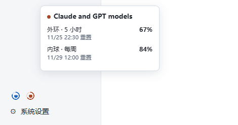

# Antigravity Quota Indicator

在 Windows 版 Antigravity 的「系统设置」上方显示两个模型组的剩余额度。左侧蓝色是 **Gemini Models**，右侧橙棕色是 **Claude and GPT models**。外环表示 **5 小时剩余**，内球表示 **每周剩余**。鼠标悬停或用 `Tab` 聚焦任一组，可以查看百分比和本地重置时间。按 `Esc` 收起提示。



## 安装

需要 Windows 桌面正式版 Antigravity 和 [Node.js](https://nodejs.org/) 24 或更新版本。实机验证使用 Antigravity **2.35.1** 和 Node.js **24.12.0**。

1. 从 [Releases](https://github.com/Apaang/antigravity-quota-indicator/releases) 下载并解压发布 ZIP。
2. 在解压目录打开 PowerShell，运行以下命令。

   ```powershell
   node install.mjs install
   ```

3. 完全退出 Antigravity，再从 Windows 开始菜单打开 **Antigravity (Quota Indicator)**。进入一个会话并展开左侧栏。

若使用自定义安装路径，可提供完整的 `Antigravity.exe` 路径。

```powershell
node install.mjs install --app-path "D:\Apps\Antigravity\Antigravity.exe"
```

安装会把插件放到 `~/.gemini/config/plugins/local-quota`，并在 Antigravity 的 `config.json` 中启用 `local-quota/quota`。专用快捷方式负责启用本机调试端口，现有 Antigravity 快捷方式可以照常使用。[Antigravity Sidecar 配置](https://antigravity.google/docs/sidecars#user-configuration-configjson)

### 更新与卸载

更新时解压新版并重新运行安装命令。运行卸载命令会移除插件管理的文件、Sidecar 配置项和专用快捷方式。重新打开 Antigravity 可立即清掉窗口里仍存活的指示器。

```powershell
node install.mjs uninstall
```

## 排障

```powershell
node install.mjs doctor
```

| 现象 | 处理方式 |
| --- | --- |
| 找不到调试端口，或端口无响应 | 完全退出 Antigravity，再用 **Antigravity (Quota Indicator)** 启动。 |
| 能连接主窗口，找不到设置按钮 | 展开左栏并进入一个会话。客户端改版也可能让侧栏挂载点失效。 |
| 已挂载，暂无额度 | 确认已登录，并在 Antigravity 自带的「查看用量」里核对套餐是否提供对应额度。 |
| 主窗口可连接，指示器仍未挂载 | 到 `~/.gemini/antigravity/sidecar_data/` 下找到此插件的 Sidecar 日志。提 Issue 时只贴必要的错误文本。 |

## 数据与兼容性

这是独立的社区插件。它通过 Antigravity 自带的 Sidecar 和动态本机调试端口运行，依赖当前桌面版的内部配额响应和侧栏结构。客户端更新后若失效，请在 [Issues](https://github.com/Apaang/antigravity-quota-indicator/issues) 附上 Antigravity 版本及 `doctor` 的输出。

插件只请求本机 Antigravity 配额服务，并在内存中短暂缓存结果。渲染窗口仅接收模型组、剩余比例和重置时间。调试端口是 Antigravity 启动选项，本机其他进程也可能访问。退出从专用快捷方式启动的实例即可结束该调试会话。

## 开发

项目使用 Node.js 内建模块和测试运行器。

```powershell
npm.cmd run check
npm.cmd test
```

入口为 `install.mjs`。`sidecars/quota/main.mjs` 查询配额，`sidebar-bridge.mjs` 识别桌面窗口，`sidebar.js` 渲染指示器。

本项目采用 [MIT](LICENSE)。参考项目和相关版权声明见[第三方许可](THIRD_PARTY_NOTICES.md)。
